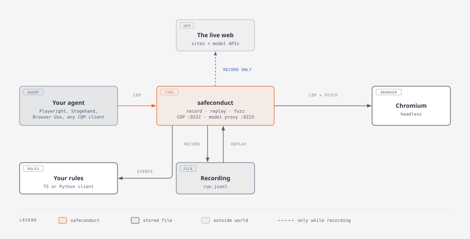
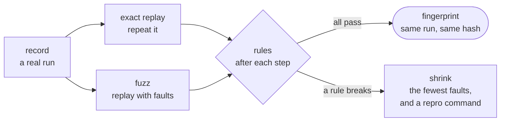

# safeconduct

[](https://crates.io/crates/safeconduct)
[](https://www.npmjs.com/package/safeconduct)
[](https://pypi.org/project/safeconduct/)
[](LICENSE)

Open infrastructure to test, contain and prove what a web agent did, and on whose behalf

> A *safe-conduct* is a document that lets a traveler pass safely through foreign territory.
> safeconduct does the same for AI agents on the web.

**Status:** early. Stage 1 (the replay browser) works and is published as 0.1.0.

## The problem

AI agents use websites as people do. They click, type, fill in forms and pay. When an agent makes an error, it is hard to find the cause. The web changes on each visit: prices, ads, times and page order are different every time. Thus, an error that you see once can be impossible to see again.

## What safeconduct does

safeconduct is a browser for testing AI agents. It records one agent run. Then it plays the run back, exactly the same, as many times as you want. With a recorded run, you can:

- Repeat an error until you find its cause.
- Add problems on purpose (slow pages, server errors, cookie walls) and see how the agent copes.
- Write rules that each run must obey, for example "never pay twice".

You do not change your agent. safeconduct looks like a normal Chrome browser to the agent.

## Try it in 2 minutes

This demo uses a synthetic shop that is saved in the repo. You need Rust, Node.js 23.6 or later, and Linux.

1. Install the runtime and a browser, and get the demo files:
   ```sh
   cargo install safeconduct
   npx playwright install chromium
   git clone https://github.com/bit2swaz/safeconduct && cd safeconduct/e2e && npm ci
   ```
2. Buy the cheapest product once. The rules find no problem:
   ```sh
   node rules.mjs fixtures/shop.jsonl clean
   ```
3. Pay twice, then go to another site. The rules catch both problems:
   ```sh
   node rules.mjs fixtures/shop.jsonl bad
   ```
   <details><summary>Expected output</summary>

   ```json
   {"code":3,"steps":6,"violations":[
     {"rule":"noDoublePayment","step":5,"message":"payment sent twice: POST http://127.0.0.1:8001/api/pay {\"order\":3388}"},
     {"rule":"allowedOrigins","step":6,"message":"left the allowed origins: GET http://127.0.0.1:8002/"}]}
   ```
   Exit code 3: the other site is not in the recording, so the replay ends there.
   </details>

4. Find the cause of a failure. A naive buyer gets 6 random faults (fuzz seed 299) and pays twice. Shrink finds the one fault that causes it:
   ```sh
   safeconduct shrink -- node shrink_test.mjs fixtures/shop.jsonl 299 0.5
   ```
   <details><summary>Expected output (the last line, about 30 seconds)</summary>

   ```json
   {"event":"shrunk","of":6,"trials":9,"reproduces":true,
    "faults":[{"kind":"drop","request":"POST http://127.0.0.1:8001/api/pay","nth":1}],
    "reproduce":"SAFECONDUCT_FAULTS=025073b4619dddaf node shrink_test.mjs fixtures/shop.jsonl 299 0.5"}
   ```
   The first payment request lost its connection. The buyer did not know if the payment went through, and sent it again.
   </details>

## How it works



Your agent connects to safeconduct over CDP (Chrome DevTools Protocol), as it connects to Chrome. safeconduct controls a headless Chromium and sees each network request.

- In **record** mode, safeconduct sends the requests to the live web and saves each answer in a file.
- In **replay** mode, safeconduct answers each request from that file. The live web is not necessary.

The page also gets a fixed clock (it starts at 2023-11-14) and a seeded random number generator. As a result, the page is the same on each replay.

### The testing loop



1. **Record** your agent once, on the real site.
2. **Replay** it exactly to debug, or **fuzz** it to find new failures.
3. **Rules** check each step.
4. When a fuzz run fails, **shrink** finds the faults that cause it, and gives a command that repeats only that failure.

## Install

You need Rust, Node.js (for Playwright's Chromium) and Linux. Other systems are not tested yet.

1. Install the runtime:
   ```sh
   cargo install safeconduct
   ```
2. Install Chromium:
   ```sh
   npx playwright install chromium
   ```
3. To write rules, install a client:
   ```sh
   npm install safeconduct   # TypeScript and JavaScript
   pip install safeconduct   # Python
   ```

## Quick start

1. Record a run. Connect your agent to `http://127.0.0.1:9222` and let it do its task. Then stop safeconduct with Ctrl-C.
   ```sh
   safeconduct record run.jsonl
   ```
2. Replay the run. Connect your agent again, to the same address.
   ```sh
   safeconduct replay run.jsonl
   ```

## Modes

| Mode | Command | Site | Model (LLM) |
|---|---|---|---|
| Record | `record run.jsonl` | live | live, and saved |
| Exact replay | `replay run.jsonl` | from the file | from the file |
| Live model | `replay run.jsonl --live-model` | from the file | live |
| Fuzz | `replay run.jsonl --fuzz 5` | from the file, with faults | live |

**Exact replay** repeats the whole run: the site, the model answers and the requests that the agent process sends itself. It works with the site down and with no API key. A request that is not in the file ends the run with exit code 3.

**Fuzz** adds seeded faults to the replayed site:

- A page load can be slow, or it can get a popup (a cookie wall) or a banner (text that moves the layout).
- Other requests can be slow, get a 503 error or lose the connection.
- A request that is not in the file gets a 503 or a lost connection, and the run continues.

The same seed (`--fuzz 5`) gives the same faults on each run. Use `--fault-rate 0.25` to set the share of requests that get a fault.

## Connect your agent

| Agent | How to connect |
|---|---|
| Playwright | `chromium.connectOverCDP('http://127.0.0.1:9222')` |
| Stagehand v4 | `localBrowser.connect({ cdpUrl: 'http://127.0.0.1:9222' })` |
| Browser Use 1.0 | `Browser(cdp_url='http://127.0.0.1:9222')` |

<details><summary>Playwright: a full example</summary>

```ts
import { chromium } from 'playwright-core';
const browser = await chromium.connectOverCDP('http://127.0.0.1:9222');
const page = await browser.contexts()[0].newPage();
await page.goto('https://shop.example/');
```
</details>

<details><summary>Stagehand v4: a full example</summary>

```ts
import { localBrowser, Stagehand } from '@browserbasehq/stagehand';
const browser = await localBrowser.connect({ cdpUrl: 'http://127.0.0.1:9222' });
const stagehand = await Stagehand.create({ browser, model: { modelName: 'google/gemini-3.5-flash-lite', apiKey: process.env.GEMINI_API_KEY } });
const page = await browser.context.newPage();
await page.goto('https://shop.example/');
await stagehand.act('add the cheapest product to the cart');
```
Stagehand calls its model from inside the browser. safeconduct records these calls with no other settings.
</details>

<details><summary>Browser Use 1.0: a full example</summary>

```python
# GOOGLE_GEMINI_BASE_URL=http://127.0.0.1:9223 HTTP_PROXY=http://127.0.0.1:9223 python agent.py
import asyncio
from browser_use import Agent, Browser

async def main():
    agent = Agent('Add the cheapest product to the cart.', llm='google:gemini-3.5-flash-lite',
                  browser=Browser(cdp_url='http://127.0.0.1:9222'))
    await agent.run(max_steps=15)

asyncio.run(main())
```
Always give `llm=`. Without it, Browser Use 1.0 uses its paid cloud model.
</details>

If your agent calls its model from inside the browser (Stagehand v4), safeconduct records the calls automatically.

If your agent calls its model from its own process, point the model base URL to the model proxy on port 9223. Also set `HTTP_PROXY` to port 9223, so that safeconduct records the site requests of the agent process. safeconduct never saves API keys.

| Model API | Base URL |
|---|---|
| Gemini | `GOOGLE_GEMINI_BASE_URL=http://127.0.0.1:9223` |
| OpenAI | `OPENAI_BASE_URL=http://127.0.0.1:9223/v1` |
| Anthropic | `ANTHROPIC_BASE_URL=http://127.0.0.1:9223` |
| Gemini, OpenAI-compatible API | `http://127.0.0.1:9223/v1beta/openai/` |

Plain answers, streamed answers (SSE) and tool calls replay exactly. The tests use the official OpenAI and Anthropic SDKs, and a Browser Use agent with an OpenAI-shaped model.

## Rules

A rule is a function. safeconduct calls it after each step of the agent, and the rule returns a message if the step breaks it. A step ends when the agent did an action, the page sent requests, and the network became quiet again.

The thin clients start safeconduct for you and run your rules. Two rules come with them: stay in the allowed origins, and never submit a payment twice.

TypeScript:

```ts
import { replay, allowedOrigins, noDoublePayment } from 'safeconduct';
const run = await replay('run.jsonl', { rules: [allowedOrigins(['https://shop.example']), noDoublePayment('/api/pay')] });
// connect your agent to run.endpoint and run it
await run.close(); // run.violations: [{ rule, step, message }]
```

Python:

```python
from safeconduct import replay, allowed_origins, no_double_payment
with replay('run.jsonl', rules=[allowed_origins(['https://shop.example']), no_double_payment('/api/pay')]) as run:
    ...  # connect your agent to run.endpoint and run it
print(run.violations)
```

To write your own rule, write a function `(step, all_events)` that returns a message, or nothing. `step.events` holds the events of that step.

## Fingerprint and shrink

At the end of each run, safeconduct gives the run a **fingerprint**. The fingerprint is a hash of all the requests of the run. Two runs with the same fingerprint sent the same requests. The clients give it as `run.fingerprint`.

**Shrink** finds the cause of a failure. It runs your failing fuzz test again and again, with fewer faults each time. Then it gives the smallest set of faults that still makes the test fail.

1. Write a test that runs your agent on `safeconduct replay --fuzz SEED`. The test must exit with a nonzero code when it fails, for example when a rule breaks.
2. Run the test through shrink:
   ```sh
   safeconduct shrink -- node my_test.mjs
   ```
3. Read the `shrunk` event. It gives the faults that cause the failure, and a command that runs the test with only these faults.

Example from `e2e/run.sh`: a buyer gets 6 faults and pays twice. Shrink finds the one fault that causes it: the first payment request lost its connection, and the buyer sent the payment again.

## Events and exit codes

safeconduct writes one JSON event per line to stdout.

<details><summary>All events</summary>

| Event | Meaning |
|---|---|
| `ready` | The browser is ready. It gives the CDP address and the model proxy address. |
| `request` | The page or the agent process sent a site request. POST requests include the body. |
| `step` | One step of the agent ended. |
| `served` | Replay answered a request from the file. |
| `off-recording` | A request is not in the file. In exact replay, the run ends. |
| `llm-drift` | A model prompt is different from the recorded prompt. |
| `fault` | Fuzz mode added a fault. |
| `unsupported` | The agent process sent an HTTPS request through `HTTP_PROXY`. safeconduct cannot record it. |
| `end` | The run ended. It gives the fingerprint, the number of steps and the exit code. |

</details>

| Exit code | Meaning |
|---|---|
| 0 | The run ended normally (Ctrl-C or SIGTERM). For `shrink`: the result fails again on its own. |
| 1 | `shrink` only: the test did not fail, or the shrunk result did not fail again. |
| 2 | The command line is not correct. |
| 3 | Exact replay: a request is not in the recording, so the run ended. |

## Tests

`e2e/run.sh` tests every part, end to end, with Playwright, Stagehand and Browser Use on a synthetic shop (`sites/shop`). It uses saved agent runs, so it makes no model calls.

`e2e/run.sh --live` uses real agents and a real model (the free Gemini tier). Put `GEMINI_API_KEY` in `.env` first.

`e2e/stress.sh` puts the CPU under full load. It runs several runtimes at the same time and makes sure that they give the same results. Then it runs `e2e/run.sh` again and again, and counts the checks that failed.

## FAQ

<details><summary>Is this the same as session replay (a video of the session)?</summary>

No. Session replay records a video or a DOM log that you watch. safeconduct runs the agent again, on the same site, with the same model answers. You can change the agent, add faults and check rules.
</details>

<details><summary>Why did my replay end with <code>off-recording</code>?</summary>

The agent sent a request that is not in the recording. Usually the agent did something different from the record run, or the page put a random value in a URL. Record the run again, or use `--live-model` or `--fuzz` so that the run continues.
</details>

<details><summary>Which model APIs does it support?</summary>

Gemini, OpenAI and Anthropic, plain and streamed, with tool calls. Any API that sends its requests through the model proxy (port 9223) or calls a model host from the browser works the same way.
</details>

<details><summary>Does my API key go into the recording?</summary>

No. safeconduct does not save request headers, and it removes a `key=` value from saved URLs. The tests make sure that the key is not in the recording.
</details>

<details><summary>Does it work on macOS or Windows?</summary>

Not yet. It is tested on Linux only.
</details>

## Plan

| Stage | Product | What it does |
|---|---|---|
| 1 | replay browser | Records and replays agent runs exactly. Adds seeded faults, checks rules after each step, and cuts a failed run down to the smallest run that fails. |
| 2 | guard | An open policy engine between an agent and the browser. It stops unsafe actions before they occur. |
| 3 | receipts | Proof of what an agent did: zkTLS attestations, an archive, a deterministic re-render and a hash-chained log of actions. |
| 4 | gate | An open gate that sites can host. It checks agent signatures and delegation, applies the access policy of the site and accepts payment (HTTP 402). |

## License

Apache-2.0
